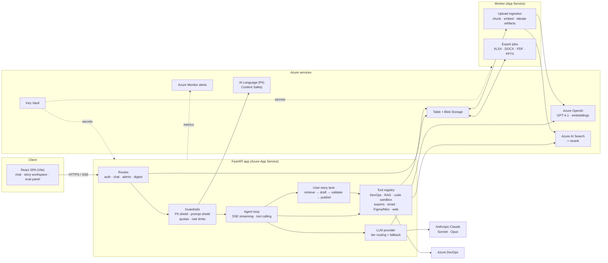

# AI Product Assistant

An AI agent for product teams. It answers questions about the backlog, writes and
refines user stories (from text or from UI screenshots), analyses data files,
triages email, and produces Excel, Word, PDF and PowerPoint deliverables. Guardrails
for privacy, prompt injection and cost are built in.

The backend is Python/FastAPI, the frontend is React (Vite), and it runs on Azure.

> **About this public version.** I first built this during a Product Owner internship
> at a bank, as an internal assistant for a digital-channels product team. For this
> repository, all internal data, identifiers, infrastructure names and branding
> have been removed. The product is renamed "AI Product Assistant". The company in
> the examples, "Acme", is fictional, and every bundled data file and test fixture
> is **synthetic**.

---

## Why it exists

Product Owners on a busy digital team spend much of their week on repetitive
knowledge work:

- reading Azure DevOps to answer "what's the status of X?";
- writing user stories in the team's house format;
- turning Figma screens into acceptance criteria;
- building the same Excel/PowerPoint reports every sprint;
- sorting a shared inbox.

The assistant automates this work, grounded in the team's real backlog,
documentation and design files. It keeps a human in the loop: nothing is written
to the backlog without explicit confirmation, and every generated story can be
reviewed, edited and fed back into the system.

## Key capabilities

| Area | What it does |
| --- | --- |
| **Agent with tool use** | Streaming (SSE) agent loop with parallel tool calls, an iteration budget, tool-result truncation and conversation-aware follow-ups. Around 20 tools sit in a pluggable registry (`tool_registry.py`). |
| **RAG** | Hybrid vector + keyword retrieval over Azure AI Search indexes (backlog, knowledge base, story examples), followed by **post-retrieval reranking** (Cohere Rerank). Ambiguous queries get domain hints. |
| **User-story generation** | A dedicated "story lane" (`user_story_lane.py`). It retrieves similar stories, curated examples, domain profiles, policy packs and Figma flows, then drafts a structured story, validates it against the house template and scores its quality before publishing. |
| **Screenshot → story** | `screenshot_to_us` sends UI mock-ups or screenshots to a **vision model**, which returns user stories with testable acceptance criteria. |
| **Backlog integration** | Azure DevOps WIQL queries, hierarchy navigation (epic → feature → story), KPI computation, semantic search, and create/refine work items (only after confirmation). Read-only Figma and Miro integrations. |
| **Data analysis sandbox** | Upload CSV/XLSX/XLSB/PDF/DOCX. A restricted Python sandbox (`code_interpreter.py`) runs pandas/DuckDB with import and timeout limits, cross-file SQL, polymorphic-schema profiling, a data dictionary and charts. |
| **Document generation** | Branded XLSX, DOCX, PDF, HTML and CSV exports, plus a multi-stage **PPTX pipeline** (brief → plan → review → render). |
| **Email triage** | Classifies exported inbox CSV/text files by urgency and intent, then generates Outlook draft/action scripts for the user to run locally. |
| **PII shield** | Azure AI Language PII detection plus regex pre-masking (IBAN, tax ID, card number, phone, email…). Masking is reversible within a request, so external models never see raw personal data. Tabular uploads also get a PII column scanner. |
| **Prompt shield** | Azure AI Content Safety Prompt Shields check user input and retrieved documents for jailbreaks and indirect prompt injection. Fail-closed by default. |
| **Quotas & rate limits** | Per-tier hourly/daily token quotas, a per-user daily spend cap, chat budget per minute, and per-route rate limiting (slowapi). |
| **Feedback loop** | Thumbs up/down and edit tracking on generated stories. Accepted drafts become **curated examples** that feed retrieval. Writer profiles learn each author's style. |
| **Evaluation** | Golden sets and a 4-layer eval runner (`tests/runners/run_eval.py`): RAG metrics, tool contracts, an LLM-as-judge **arena** against a generic LLM, and user-story quality. It produces an HTML report. |
| **Multi-LLM tier routing** | `fast`/`vision` → Azure OpenAI **GPT-4.1** (EU data-zone deployments); `standard`/`pro` → Anthropic **Claude Sonnet / Opus** (direct API or Azure AI Foundry). Automatic fallback and provider-governance checks. |
| **Async workers** | A separate worker process handles upload ingestion (chunking, embeddings, tabular artifacts) and long exports. Jobs persist in Table Storage. |
| **Security hardening** | JWT in HttpOnly cookies with key rotation, a token blacklist, CSP, an origin allow-list, field-level encryption, optional ClamAV upload scanning, and secret redaction in logs. |

## Architecture



**Request flow (chat).** The user sends a message. Auth and rate limits are checked,
then the token quota. The prompt shield inspects the input and the PII shield masks
personal data. The agent picks tools (often several in parallel) and streams
progress events. Tool results are trimmed and grounded. The LLM is chosen by tier,
and its answer is unmasked before it reaches the browser. Long-running work
(large uploads, big exports) goes to the worker through a job table, and the UI
polls for status.

**Model routing.**

| Tier | Default model | Used for |
| --- | --- | --- |
| `fast` | Azure OpenAI GPT-4.1 | classification, short answers, routing |
| `vision` | Azure OpenAI GPT-4.1 | screenshots / mock-ups → stories |
| `standard` | Claude Sonnet (falls back to Azure OpenAI if Anthropic is not configured) | default chat and story drafting |
| `pro` | Claude Opus | long-form analysis, presentations |

Every tier is overridable with environment variables (`LLM_TIER_*`).

## Tech stack

- **Backend:** Python 3.12, FastAPI, Pydantic v2, httpx (async), slowapi, pandas,
  DuckDB, openpyxl / XlsxWriter, python-pptx, python-docx, fpdf2, pdfplumber,
  tiktoken, azure-identity.
- **Frontend:** React 18, Vite 6, DOMPurify, Plotly, Azure Speech SDK (voice input).
- **AI:** Azure OpenAI (GPT-4.1, text-embedding-3-small), Anthropic Claude
  (Sonnet / Opus), Cohere Rerank, Azure AI Language, Azure AI Content Safety, Azure
  AI Document Intelligence, Brave Search (optional web search).
- **Azure:** App Service (API and worker), Table Storage, Blob Storage, AI Search,
  Key Vault, Monitor alerts, deployment slots with swap/rollback scripts.
- **Quality:** pytest (~900 tests, LLM calls mocked), a 4-layer eval suite, and GitHub
  Actions CI (Python 3.11/3.12 matrix and frontend build) with **CodeQL** analysis.

## Project structure

```
.
├── app.py                    # FastAPI app, middleware, upload/export endpoints, SPA hosting
├── routes_*.py               # auth, chat, admin (metrics, feedback, indexes), digest
├── agent.py                  # agent loop, streaming, tool orchestration
├── llm_provider.py           # multi-provider LLM abstraction + tier routing
├── tools*.py, tool_registry.py   # tool definitions and handlers
├── user_story_lane.py        # end-to-end user-story generation pipeline
├── story_*.py                # retrieval assets: curated corpus, flow map, policy packs, indexes
├── pii_shield.py, prompt_shield.py, pii_column_scanner.py, provider_governance.py
├── token_quota.py, rate_limit_storage.py, auth*.py, field_encryption.py
├── code_interpreter.py, tabular_*.py, data_dictionary.py   # data-analysis sandbox
├── export_engine.py, xlsx_engine.py, pptx_engine.py, presentation_*.py
├── upload_worker.py, export_worker.py, worker_entrypoint.py
├── storage.py, job_store.py  # Azure Table/Blob persistence
├── config.py                 # every setting, read from env (see .env.example)
├── data/                     # SYNTHETIC sample retrieval assets
├── frontend/                 # React SPA (built into static/)
├── scripts/                  # index setup/sync, smoke test, Azure infra & deploy helpers
├── tests/                    # unit/integration tests + eval layers (camada_a…d) + datasets
└── .github/workflows/        # CI, CodeQL, manual deploy
```

## Running locally

**Prerequisites:** Python 3.12, Node 18+.

```bash
# 1. Backend
python -m venv .venv && source .venv/bin/activate
pip install -r requirements-dev.txt

# 2. Frontend (builds into static/)
npm ci
npm run build

# 3. Configuration
cp .env.example .env    # then fill in the services you have
# load it into your shell, e.g.:  set -a && source .env && set +a

# 4. Start the API (serves the SPA at http://localhost:8000)
uvicorn app:app --reload --port 8000
# optional: background worker for uploads/exports
python worker_entrypoint.py
```

For frontend hot reload, run `npm run dev` (Vite on :5173, which proxies `/api` to :8000).

A full run needs at least an Azure Storage account and an Azure OpenAI deployment.
Every other integration is optional and switches off cleanly when its credentials
are missing: AI Search, Anthropic, DevOps, PII/Content Safety, Speech, Figma, Miro
and web search.

### Tests and evaluation

```bash
EVAL_MOCK_LLM=true python -m pytest tests -q        # no network or secrets needed
python tests/runners/run_eval.py --dry-run          # validate eval datasets
python tests/runners/run_eval.py --camada all       # run all eval layers + HTML report
```

## Notes on this version

- `data/*.json` and `tests/datasets/*.json` contain small **synthetic** examples. They
  use a fictional "Acme" portal and placeholder people such as `jane.doe@example.com`.
  Retrieval quality depends on real curated data, so story suggestions in this
  repository only show the mechanics.
- Azure resource names, the DevOps organisation/project and area paths are all
  configuration (`.env.example`). None are hard-coded.
- The UI and the LLM prompts are in European Portuguese (pt-PT), the language of the
  original team.
